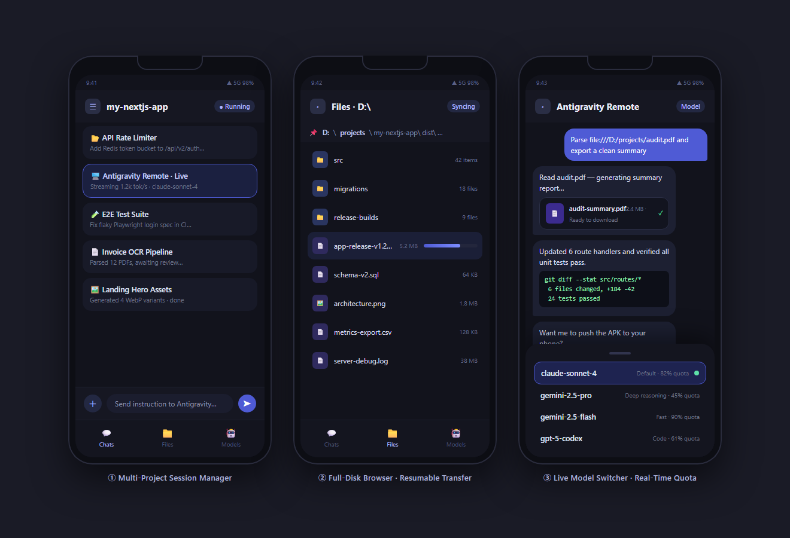
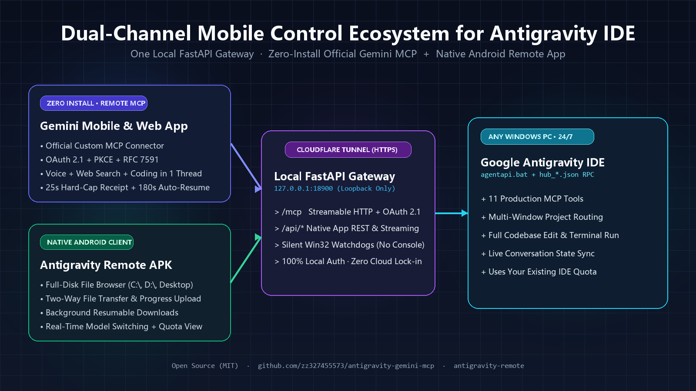

# Antigravity Remote

**Your Antigravity IDE, in your pocket — with full-disk file transfer, resumable downloads, and live model switching.**

[](LICENSE)
[](#requirements)
[](#quick-start-3-minutes)
[](#you-do-not-need-a-cloud-pc)

---

## What it looks like



*Conversation management · full-disk file manager · live model switching with remaining quota*

---

## What this is

A **native Android client** plus a **local Windows gateway** that puts your running Google Antigravity session on your phone. The IDE keeps running on the machine where your code lives — your phone just becomes a live remote for it.

Unlike browser-only remotes, this one lets you **browse the entire disk** of your computer, **push and pull files in both directions**, and **download multi-GB artifacts with resume** while your screen is off.

> **Want zero app install?** Use the companion project [**antigravity-gemini-mcp**](https://github.com/zz327455573/antigravity-gemini-mcp) — it plugs Antigravity into the **Gemini app you already have** through Google's official custom MCP connector.

---

## Why not just use Google's built-in Remote Control?

Google shipped Remote Control in Aug 2026, and it is good. Here is the honest comparison — pick the one that fits your workflow.

| | Google Remote Control | **Antigravity Remote (this repo)** |
|---|---|---|
| Interface | Browser page / home-screen PWA | Native Android app |
| Full-disk browse (`C:\`, `D:\`, desktop) | — | ✅ |
| Two-way file transfer phone ↔ PC | — | ✅ |
| Resumable download (survives screen-off) | — | ✅ built-in foreground service |
| Live model list + remaining quota | — | ✅ |
| Simultaneous multi-machine routing | ✅ | per-instance via tunnel |
| Chinese UI | partial | ✅ native |
| Setup | zero | self-hosted, ~3 min |
| Cost | subscription tier dependent | free, MIT |

**Use the official one if** you only need to watch progress and approve actions in a browser.
**Use this one if** you regularly move files, pull build artifacts, or need to read something off your desktop while away from it.

---

## You do not need a cloud PC

The old requirement was "an always-on cloud PC". That was wrong. You need **any Windows machine that is powered on** — a home desktop, an office PC, a mini PC, a laptop on a shelf, or a cloud PC if you happen to have one.

The only thing that must stay alive is:

1. Antigravity IDE open on that machine
2. `python gateway.py` running
3. one tunnel process

Close the laptop lid and the session pauses. That's the whole constraint.

---

## Requirements

| Side | Needs |
|---|---|
| Windows host | Windows 10/11, Python 3.9+, Google Antigravity IDE running |
| Phone | Android 8.0+ |
| Network | A tunnel — Cloudflare Tunnel (recommended) or any VPS + FRP |
| Optional | A domain on Cloudflare (only for a stable URL; a free temp tunnel works for evaluation) |

---

## Features

- **Project & session management** — switch projects, expand history, start standalone conversations.
- **Live model switching** — reads the model list and remaining quota from the desktop IDE in real time.
- **Full-disk file manager** — browse desktop / `C:\` / `D:\` and any folder, upload from phone to the current directory, download from PC to phone.
- **Streaming uploads** — attachments upload with a live progress bar into `<project>/_mobile_uploads/`.
- **Resumable downloader** — authenticated chunked HTTP download in a foreground service; survives backgrounding, screen-off and network blips. Files land in `Download/AntigravityRemote/`.
- **Chat UX** — long-press partial text selection, one-tap copy, and `file:///` links in AI replies auto-render as inline image previews or download cards.

---

## Architecture




```
  Phone (Android)                        Windows host
  ┌───────────────┐   HTTPS     ┌──────────────────────────────┐
  │ Antigravity   │ ──────────► │ cloudflared / FRP tunnel      │
  │ Remote APK    │             │        │                      │
  │               │ ◄────────── │        ▼                      │
  │ • sessions    │   stream    │ gateway.py  :18900            │
  │ • files ⇅     │             │        │  (auth_token)        │
  │ • models      │             │        ▼                      │
  │ • downloads   │             │ agentapi.bat → Antigravity IDE│
  └───────────────┘             │        └── your workspace     │
                                └──────────────────────────────┘
```

The gateway listens on loopback only. Nothing is exposed until you deliberately attach a tunnel, and every route requires `auth_token`.

---

## Quick start (3 minutes)

### 1. Host side

```bash
cd server
pip install -r requirements.txt
copy config.example.json config.json
```

Edit `server/config.json`:

```json
{
  "host": "127.0.0.1",
  "port": 18900,
  "auth_token": "use-a-long-random-string",
  "workspace_roots": ["D:\\YourWorkspace"],
  "default_model": "MODEL_PLACEHOLDER_M526"
}
```

Start Antigravity IDE first, then:

```bash
python gateway.py
```

Optional keepalive helpers (silent, no console window): `watch_gateway.py`, `watch_cloudflared.py`, `launch_hidden.vbs`.

### 2. Tunnel

**Evaluation (free, random URL):**

```bash
cloudflared tunnel --url http://127.0.0.1:18900
```

**Stable URL (recommended):** create a named tunnel `agy-remote` pointing at `http://127.0.0.1:18900`, attach your domain. `watch_cloudflared.py` already expects a tunnel named `agy-remote` — edit `CF_EXE` and the tunnel name if yours differ.

**VPS + FRP alternative:** forward `18900` to your server and put HTTPS in front of it.

### 3. Phone side

```bash
cd android
./gradlew assembleDebug
```

Install the APK, open settings, enter:

- **Server URL** — your tunnel URL, e.g. `https://agy.example.com`
- **Token** — the `auth_token` from `config.json`

Done. The session list should populate immediately.

---

## Self-hosting checklist

- [ ] `auth_token` is long and random (32+ chars) — it is the only gate in front of your entire disk
- [ ] `workspace_roots` lists only folders you are willing to expose
- [ ] tunnel URL is HTTPS (Cloudflare gives you this by default)
- [ ] `config.json` is never committed — it is in `.gitignore`
- [ ] rotate the token if you ever paste it into a screenshot

---

## FAQ

**Does my computer have to stay on?**
Yes. The agent runs locally; the phone is a remote for it. If the host sleeps, the session pauses.

**Is this using my Antigravity credentials somewhere else?**
No. The agent still runs inside Antigravity and consumes your normal quota. This project relays the local session over an authenticated tunnel — it does not take your OAuth token to a third-party agent runtime. If you want a path that goes through Google's officially supported integration surface instead, use [**antigravity-gemini-mcp**](https://github.com/zz327455573/antigravity-gemini-mcp) (custom remote MCP connector).

Note that Antigravity's Additional Terms restrict accessing the Service through third-party software. This is a self-hosted tool for your own machine; use it with that in mind and keep it off shared accounts.

**Will an Antigravity update break it?**
Possibly. The gateway talks to Antigravity's local `agentapi.bat` and per-window `hub_*.json` state files, which are internal interfaces. If a release changes them, the gateway needs a patch. Pin your IDE version if stability matters.

**Android only?**
Today, yes. The gateway is plain HTTP + JSON, so an iOS or web client is a weekend port — contributions welcome.

**Does it work over 4G/5G?**
Yes. Any network the tunnel is reachable from.

---

## Related

- [**antigravity-gemini-mcp**](https://github.com/zz327455573/antigravity-gemini-mcp) (v1.1.0) — drive Antigravity from the Gemini app via remote MCP with OAuth 2.1 + PKCE, 25s hard-capped receipts & 180s fingerprint auto-resume (zero install).
- [antigravity-desktop-zh-cn](https://github.com/zz327455573/antigravity-desktop-zh-cn) — Simplified Chinese localization pack for the desktop app.

---

## 中文说明

**Antigravity Remote（反重力遥控器）** = 原生 Android 客户端 + Windows 本地 FastAPI 网关，把桌面端 Google Antigravity 的会话搬到手机上，并支持**全盘文件双向互传**与**断点续传下载**。

### 门槛比想象中低：不需要云电脑

任何一台**开着的 Windows 电脑**都行——家里台式机、店里电脑、闲置小主机、笔记本，都算。只要三件事活着：Antigravity IDE 开着、`python gateway.py` 跑着、隧道通着。

### 与官方 Remote Control 的差别

官方强在"零部署、浏览器即用"；本项目的真差异是四件官方没做的事：
1. **全盘浏览** `C:\`、`D:\`、桌面任意目录
2. **手机 ↔ 电脑双向传文件**
3. **断点续传下载**，锁屏、切后台不断连
4. **模型实时切换 + 剩余额度显示**

### 三步跑起来

1. **电脑端**：`cd server` → `pip install -r requirements.txt` → 复制 `config.example.json` 为 `config.json`，改 `auth_token` 和 `workspace_roots` → 先开 Antigravity，再 `python gateway.py`
2. **隧道**：试用直接 `cloudflared tunnel --url http://127.0.0.1:18900`（免费随机域名）；长期用建一个名为 `agy-remote` 的命名隧道挂自己域名
3. **手机端**：`cd android && ./gradlew assembleDebug`，装 APK，设置里填隧道地址 + `auth_token`

> 想彻底不装 App？用配套项目 [**antigravity-gemini-mcp**](https://github.com/zz327455573/antigravity-gemini-mcp)，直接在你手机已有的 Gemini 里通过官方自定义 MCP 连接器操控。

---

## 🔒 Security

- 切勿提交 `server/config.json`、真实域名、公网 IP 或任何令牌。  
  Never commit `server/config.json`, private domains, public IPs, or tokens.
- 网关默认只监听 `127.0.0.1`，不挂隧道就不对外暴露；挂了隧道后 `auth_token` 是唯一门禁，请务必用长随机串。  
  The gateway binds loopback by default. Once a tunnel is attached, `auth_token` is the only gate in front of your filesystem — make it long and random.

## License

MIT — see [LICENSE](LICENSE).
